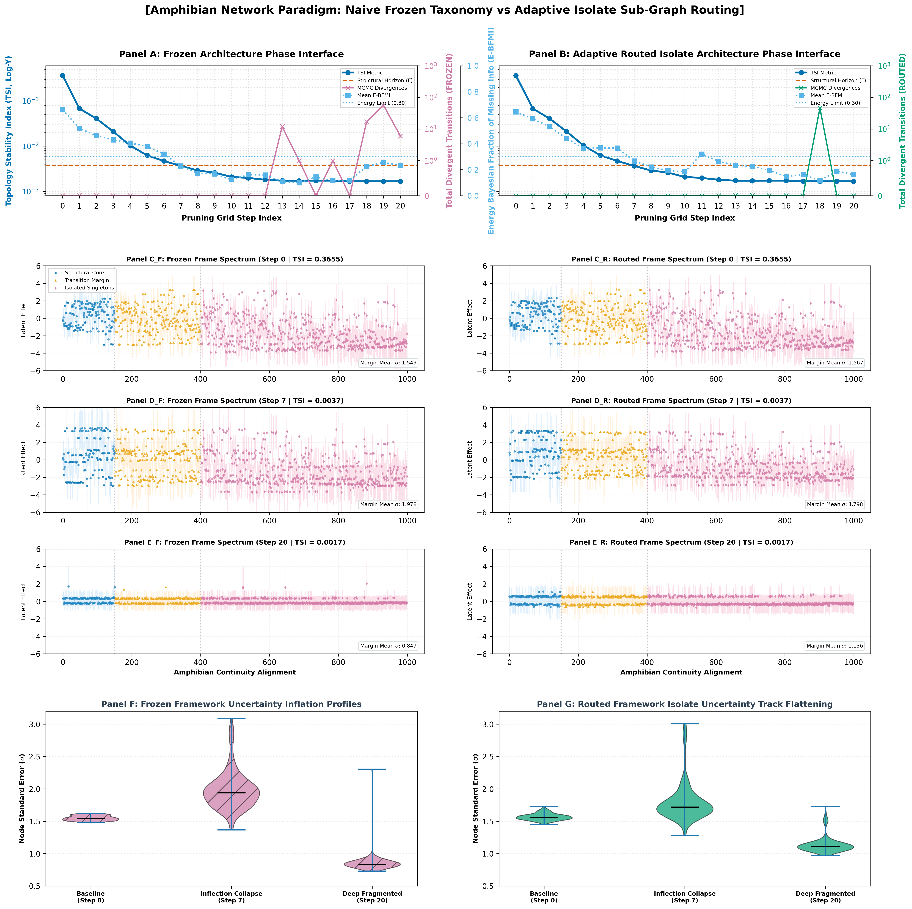

# Constraints that endure: Assessing model robustness in vertebrate ecology

This repository contains the code to run Bayesian phylogenetic generalized linear mixed models (PGLMMs) evaluating global extinction risks in terrestrial vertebrates. The pipeline builds on data and phylogenies from Munstermann et al. (2022) to separate baseline ecological traits from macro-evolutionary structures across four vertebrate classes.

## Repository structure

```text
├── amphibian_topology/                      # companion network isolation experiment
│   ├── output/                              # stability logs and plots
│   │   ├── figures/                         
│   │   │   └── phase_synthesis.png          # plots macro curves and node errors
│   │   ├── node_variance_frozen.csv         # logs node results for the frozen model
│   │   ├── node_variance_routed.csv         # logs node results for the routed model
│   │   ├── pruning_transitions_frozen.csv   # logs macro results for the frozen model
│   │   └── pruning_transitions_routed.csv   # logs macro results for the routed model
│   ├── utils/                               
│   │   └── plot_synthesis.py                # script to compile figure 1 panels
│   └── prune_trees.py                       # main tree pruning experiment script
├── data/                                    # original trait tables and phylogenetic trees
│   ├── all_sumthreats.csv                   
│   ├── amphibian100trees.nex                
│   ├── amphibians.csv                       
│   ├── bird100trees.nex                     
│   ├── birds.csv                            
│   ├── mammal100trees.nex                   
│   ├── mammals.csv                          
│   ├── reptiles.csv                         
│   └── squamate100trees.nex                 
├── output/                                  # main replication outputs and results
│   ├── figures/                             # plots generated from metrics
│   │   ├── fig1_primary_threats.png         # assessment of threats to vertebrates
│   │   ├── fig2_multistressor_loading.png   # vertebrate multistressors
│   │   └── fig3_variance_profiles.png       # variance by category and class                     
│   ├── vertebrate_connectivity_summary.csv  # connectivity profiles by vertebrate class
│   └── global_bayesian_trivar_metrics.csv   # metrics from main replication
├── utils/                                   # core utilities
│   ├── bayesian_engine.py                   # PyMC model configuration and tree parser
│   ├── check_hypotheses.py                  # verification test
│   └── generate_plots.py                    # figure generator
├── .gitignore                               
├── calculate_connectivity.py                # measure topology of datasets via pytstability
├── README.md                                # project documentation
├── requirements.txt                         # pinned package dependencies
└── run_pipeline.py                          # main script
```

## Background & data sources

The original study examines how ecological traits shape macro-ecological vulnerability scales globally across terrestrial vertebrates using standard, homoskedastic frequentist phylogenetic mixed models.

* **Original Paper:** Munstermann, Maya J, Heim, Noel A, McCauley, Douglas J, Payne, Jonathan L, Upham, Nathan S, Wang, Steve C, & Knope, Matthew L (2022). A global ecological signal of extinction risk in terrestrial vertebrates. *Conservation Biology*, 36(3), e13852. https://doi.org/10.1111/cobi.13852.
* **Data Source:** Munstermann, Maya; Heim, Noel; McCauley, Douglas et al. (2021). *A global ecological signal of extinction risk in terrestrial vertebrates [Dataset].* Dryad Digital Repository. https://doi.org/10.5061/dryad.4b8gthtcq.

### Key differences in this version
This framework adjusts the uniform variance assumptions standard in frequentist models by introducing a heteroskedastic partitioning structure:

| Architectural Component | Original Study Engine (Frequentist PGLMM) | Replicated Pipeline Engine (PyMC / JAX) |
| :--- | :--- | :--- |
| **Statistical Framework** | Frequentist maximum likelihood estimation. | Full Bayesian MCMC joint variance parameter mapping. |
| **Ecological Variance** | Assumes equal variance across all terminal tips. | Isolates unique ecological singletons to prevent overall uncertainty inflation. |
| **Evolutionary Variance** | Fixed tree topology branch scales. | Models ancient, monotypic isolates via separate variance multipliers to protect baseline trees. |

## Companion experiment: Amphibian density scan
*Located in the `amphibian_topology/` subdirectory.*

### What this experiment does
This self-contained sub-experiment tests the structural limits of our Bayesian statistical model by observing how it breaks down under extreme data conditions.

In biology, evolutionary trees typically provide a dense, highly connected map of information sharing. However, other fields (like historical linguistics) deal with deeply fractured data environments containing unique isolates that lack group context. To understand how statistical models handle this fragmentation, the `prune_trees.py` script takes a stable group of 1,000 amphibian species and **systematically severs their ancestral connections over 21 steps using an absolute distance scale**. It compares a standard baseline tracking frame (Frozen) against an adaptive isolate routing frame (Routed).

### Key findings
As data connectivity erodes from a natural unified structure into an absolute archipelago, the model highlights a distinct phase transition:
* **The Connected Baseline (Steps 0–6):** The model functions smoothly, using shared lineage paths to distribute parameter variance evenly and keep sampling errors very low.
* **The Traction Loss Frontier (Step 7):** The network hits a structural phase collapse as deep ancestral backbones break. The Topology Stability Index (TSI) falls below the critical threshold line (`Γ = 0.004`), directly predicting a drop in the sampler's exploration energy.
* **The Post-Collapse Response (Steps 8–12):** Immediately following the failure, unmitigated nodes in the **Frozen** model suffer localized uncertainty ballooning, where standard error bounds expand dramatically. By contrast, the **Routed** model isolates these drifting singletons, flattening the uncertainty tracks and maintaining variance containment through the rest of the breakdown lifecycle.



### Running the Sub-Experiment
To conduct the automated tree-pruning sweep and compile the final publication synthesis dashboard, run the following from the root directory:
```bash
python amphibian_topology/prune_trees.py
```

## Results of the main study replication

### Estimated model parameters
The table below displays the estimated parameter means generated by the pipeline and saved to `output/global_bayesian_trivar_metrics.csv`:

| Vertebrate Class | Total N Obs | Eco Singletons | Evo Isolates | Mean Beta Intercept | Mean Sigma Dense | Mean Sigma Singleton | Mean Sigma Phylo Base | Mean Sigma Monotypic |
| :--- | :---: | :---: | :---: | :---: | :---: | :---: | :---: | :---: |
| **Mammals** | 2,718 | 4 | 19 | -0.513 | 0.342 | 0.900 | 3.144 | 1.755 |
| **Birds** | 7,582 | 3 | 25 | -0.908 | 0.123 | 0.844 | 2.010 | 1.670 |
| **Squamates** | 4,185 | 1 | 10 |  0.982 | 0.286 | 0.956 | 3.499 | 2.691 |
| **Amphibians** | 3,531 | 0 | 7  | -0.402 | 0.237 |   N/A | 4.050 | 1.343 |

* `Mean_Sigma_Dense`: Residual variance for standard clustered ecological profiles.
* `Mean_Sigma_Singleton`: Residual variance assigned to hyper-rare, unique ecological profiles.
* `Mean_Sigma_Phylo_Base`: Baseline covariance scaling factor for standard tree topology.
* `Mean_Sigma_Monotypic`: Covariance scaling multiplier for ancient, taxonomically isolated lineages.

<details>
<summary><b>View expected console log output for the multi-stressor replication</b></summary>

```text
Replicating multi-stressor findings (Munstermann et al.)
--------------------------------------------------------------------------------

Top 5 primary threat rankings:
 1. AGRICULTURE                         : Impacts 4491 species
 2. LOGGING                             : Impacts 3187 species
 3. INVASIVE SPECIES & DISEASE          : Impacts 2053 species
 4. DEVELOPMENT                         : Impacts 1903 species
 5. HUNTING & TRADE                     : Impacts 1702 species

Testing multi-stressor accumulation hypothesis:
 - Low-risk pool median threats   : 2.0
 - High-risk pool median threats  : 2.0
 - Mann-Whitney U statistic       : 3002832.0
 - p-value                        : 1.770602e-16
 Result: Significant cumulative threat accumulation confirmed (p < 0.05).

Breakdown by taxonomic class:
   * REPTILIA     -> Low Median: 2.0 | High Median: 2.0 | p-val: 4.9173e-02
   * AVES         -> Low Median: 2.0 | High Median: 2.0 | p-val: 1.8607e-02
   * AMPHIBIA     -> Low Median: 2.0 | High Median: 3.0 | p-val: 1.1581e-09
   * MAMMALIA     -> Low Median: 2.0 | High Median: 2.0 | p-val: 3.2302e-01
--------------------------------------------------------------------------------
```
</details>

## Environment setup & dependencies

The core Bayesian models use JAX-accelerated sampling. While they can run on a CPU, an NVIDIA GPU is highly recommended for faster sampling times.

### Dependencies
Install the required packages using the project requirements file. This process automatically installs the [`pytstability` package](https://github.com/lingdoc/pytstability) to handle the auditing of data connectivity:
```bash
pip install -r requirements.txt
```

## How to run the replication

### 1. Audit dataset connectivity
Run the diagnostic script to check background spatial and structural data clustering across all classes before fitting models. This script uses the `pytstability` package to calculate structural density and TSI margins, logging the final class rankings to the terminal:
```bash
python calculate_connectivity.py
```

### 2. Fast-track hypothesis verification (Optional)
Run the verification script to check basic threat counts and run background ranking tests:
```bash
python utils/check_hypotheses.py
```

### 3. Fit the Bayesian model
Run the main pipeline entry script to clean the species tables, read the phylogenetic files, and execute the full tri-variance regression graphs:
```bash
python run_pipeline.py
```

### 4. Generate charts
Compile figures and variance profile charts:
```bash
python utils/generate_plots.py
```
